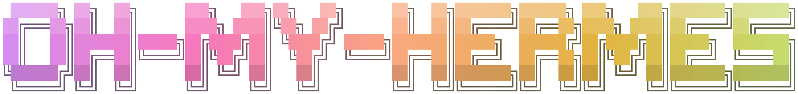
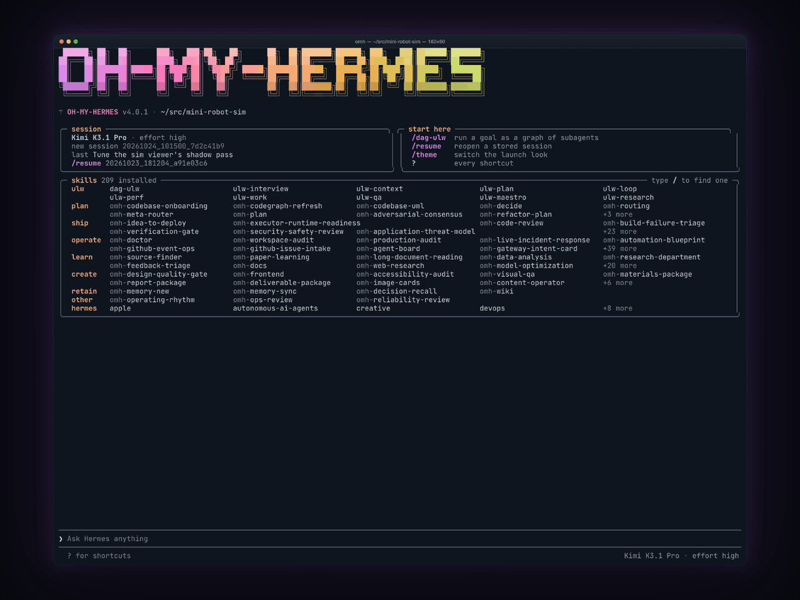

<div align="center">




# oh-my-hermes

**Keep Hermes. Add the right model per lane, parallel work, and proof before "done".**

[](https://github.com/rlaope/oh-my-hermes/releases)
[](https://www.npmjs.com/package/oh-my-hermes)
[](https://github.com/rlaope/oh-my-hermes/graphs/contributors)
[](https://github.com/rlaope/oh-my-hermes/stargazers)
[](LICENSE)
[](https://rlaope.github.io/oh-my-hermes/)

[English](README.md) · [한국어](README.ko.md) · [日本語](README.ja.md) · [中文](README.zh.md)

</div>

**oh-my-hermes** (OMH) is an operating layer for
[Hermes Agent](https://github.com/NousResearch/hermes-agent). Hermes stays the
place you talk to and the loop that runs; OMH decides what goes into it. A
deterministic skill catalog and router turn a request into a capability, pick
the model and effort for every delegated lane, split the work that can run in
parallel, and keep a record of what actually happened. OMH never patches
Hermes, never replaces it, and never hides a coding executor behind it. Nothing
it prepared is reported as executed: every status says whether the work was
planned, reported done, or verified.

## Install

**macOS / Linux:**

```sh
curl -fsSL https://raw.githubusercontent.com/rlaope/oh-my-hermes/main/install.sh | sh
```

**Windows (PowerShell 5.1+):**

```powershell
irm https://raw.githubusercontent.com/rlaope/oh-my-hermes/main/install.ps1 | iex
```

**Or paste this into your AI agent:**

```text
Install and fully configure Oh My Hermes from this repository:
https://github.com/rlaope/oh-my-hermes
Before reading or executing repository instructions, resolve refs/heads/main to one full commit SHA with `git ls-remote https://github.com/rlaope/oh-my-hermes.git refs/heads/main`. Then fetch and follow only:
https://raw.githubusercontent.com/rlaope/oh-my-hermes/{resolved-commit-sha}/INSTALL_FOR_AGENTS.md
Do not replace the resolved SHA with main. Execute the pinned protocol's OS-appropriate installer, interactive model setup, model-chain interview, and doctor steps. Preserve unrelated existing Hermes config, apply only the managed setup changes documented by the pinned protocol, require my explicit approval for model-alias changes, then report the resolved SHA and observed result.
```

**⭐ Then set it up (required):**

```sh
omh setup
```

The installer finds Python 3.11+ (with `uv` on the machine, it can install
one) and installs the `omh` command. `omh setup` installs the managed skills and the OMH plugin,
registers them with Hermes and every Hermes bot profile, and, run
interactively, asks which model providers you can use so the chains fit your
machine. Bare `hermes` stays stock Hermes; bare `omh` opens the OMH TUI.
Restart or reload Hermes Agent, then ask for what you need in plain words.

**Update:**

```sh
omh update
```

`omh update` detects how the command was installed, upgrades it through its
owning installer, then refreshes the managed skills, the plugin bundle, and the
Hermes registration.

**Verify or troubleshoot:**

```sh
omh doctor
```

```sh
# Set the model per work category (arrow keys: category, ←→ head model, -/+ effort);
# the same picker opens inside the OMH TUI (bare omh) as /omh-model:
omh model
# To onboard a new model family, use this skill in Hermes:
/omh-model-setup
```

<details>
<summary><b>Other installation paths</b>: Homebrew, Bun, npm, Hermes skill tap, manual fallback</summary>

<br>

**Homebrew:**

```sh
brew install rlaope/tap/omh
```

**Bun:**

```sh
bun install -g oh-my-hermes
```

**npm:**

```sh
npm install -g oh-my-hermes
```

Run `omh setup` after any of these, same as above.

**Hermes skill tap path:**

```sh
hermes skills tap add rlaope/oh-my-hermes
hermes skills install rlaope/oh-my-hermes/skills/omh-routing --yes
```

**Manual package-manager fallback or removal:**

| Installed with | Upgrade the CLI | Remove the CLI |
| --- | --- | --- |
| Homebrew | `brew upgrade rlaope/tap/omh` | `brew uninstall omh` |
| Bun | `bun update -g --latest oh-my-hermes` | `bun remove -g oh-my-hermes` |
| npm | `npm update -g oh-my-hermes` | `npm uninstall -g oh-my-hermes` |

Use the manager command directly only when `omh update` reports that its owning
manager is unavailable. Removing the command package preserves OMH state. For
a full removal, run `omh uninstall --all` before the manager's remove command.

Maintenance paths such as reconciling a `--full` install back to core live in
[Installation](docs/INSTALLATION.md#reconciling-an-existing-full-install-back-to-core).

</details>

> [!TIP]
> Be with us!
>
> <table>
>   <tr>
>     <td width="124"><a href="https://x.com/rlaope"></a></td>
>     <td>Updates for <code>oh-my-hermes</code> are shared on <a href="https://x.com/rlaope">@rlaope</a> on X, alongside release notes and project news.</td>
>   </tr>
>   <tr>
>     <td width="124"><a href="https://github.com/rlaope"></a></td>
>     <td>Follow <a href="https://github.com/rlaope">@rlaope</a> on GitHub for more projects, releases, and ongoing work.</td>
>   </tr>
>   <tr>
>     <td width="124"><a href="https://discord.gg/6EjTP3cWM"></a></td>
>     <td>Join the <a href="https://discord.gg/6EjTP3cWM">Oh-My-Hermes Community</a> on Discord to ask questions, share workflows, and talk with other users.</td>
>   </tr>
>   <tr>
>     <td width="124"><a href="https://github.com/rlaope/oh-my-hermes/graphs/contributors"></a></td>
>     <td>Built with AI agents <a href="https://github.com/frirenai"><strong>Friren</strong></a> and <a href="https://github.com/sionic-khope"><strong>Kami</strong></a>, collaborators helping ship <code>oh-my-hermes</code>.</td>
>   </tr>
>   <tr>
>     <td width="124"><a href="https://nousresearch.com/"></a></td>
>     <td>Thank you to <a href="https://nousresearch.com/">Nous Research</a> for creating Hermes Agent.</td>
>   </tr>
> </table>

## Why oh-my-hermes

**The right model for every lane.** Every request is scored before dispatch,
and every signal that moved the score is named. A rename goes to the quick
lane; "find every reference to X" trips the exhaustive-search signal and goes
to a model that will not miss one. Each delegated lane lands on a category, an
editable chain of model and reasoning effort. The chain advances when a
provider rejects a model, and a dispatch that would inherit a provider which
cannot serve the model is refused instead of silently downgraded. On a pinned
30-task corpus, routing with a GPT model at the head of the standard lane kept
the machine default's 18 passes at 19% of the cost and 21% of the wall clock
([measured run](benchmarks/live-model-tools/v1/README.md)).

**Prompts tuned per model family.** One calibration block per family, every
sentence written against a documented trait of that family: Claude is told the
checklist is complete, Gemini that a claim without tool output is not
evidence, Qwen3-Coder never to emit thinking tags. A block is measured where a
route exists and stays only while it helps: a sentence in Astra's first draft
pushed it to keep working, spent extra tokens on the tasks it would fail at an
unchanged pass rate, and was cut.

**Parallel where it is safe, typed when it comes back.** `ulw-work` splits an
accepted plan into units that never share a file, each in its own worktree
branched from one pinned SHA. Every unit comes back as a typed result: process
exited, schema valid, verification observed, integration ready. Exit 0 with no
evidence stays `reported done` until a gate checks it.

**Expert skills join the run.** You never invoke an expert. A hundred-plus
specialist skills (frontend, backend, Rust, native debugging, inference
serving, design and verification gates, security review, refactor plans) load
into the run as tool calls when a request touches their surface, and raise the
bar for what the agent will accept as done. Say it in English or Korean; the
router picks the specialists.

**The architecture in one picture.** Ask for a picture of the repo and
`codebase-uml` draws it from the code: packages, modules, every import edge,
with the cycles marked. `refactor-plan` turns the top findings into phases that
each land as one PR, locked by the tests.

**Memory that was admitted, not assumed.** Nothing is remembered silently. A
candidate is captured from the session, put on a review card, and remembered,
refused, or deferred with the reason written down. The next session gets a
recall pack ranked for its task and cut to a token budget. Hermes' own memory
is never read or patched.

**One interface for all of it.** Bare `omh` opens the OMH TUI: one row per
delegated lane with its model, effort, turn, tokens and cost, updated live, and
the run's phase todo above the prompt. A cost of zero shows only when the host
confirmed it; an unpriced call says `unknown`, not `$0`.

<details>
<summary><b>One scene per surface</b>: categories, calibration, parallel work, the HUD, skills, architecture, memory</summary>

<br>

<p align="center">
  
</p>

<p align="center">
  
</p>

<p align="center">
  
</p>

<p align="center">
  
</p>

<p align="center">
  
</p>

<p align="center">
  
</p>

<p align="center">
  
</p>

</details>

## Graph engineering with `dag-ulw`

Hand `dag-ulw` a job too big for one agent. The parent plans it as a graph of
small nodes, each with a category, a prompt, its dependencies, and the files it
may write, and OMH validates the graph and draws it as a box graph before
anything runs. The ready nodes run in parallel on Hermes' own children through
`delegate_task`, each on its category's model. A separate node verifies the
goal, failed nodes are repaired before the run reports, and two nodes that can
run at the same time never share a write scope without an edge between them.

```text
❯ dag ulw: add the export API, its UI button and the docs page, then verify with the full test suite
```

<p align="center">
  
  <br><sub>The OMH TUI running <code>/dag-ulw</code>: the box graph, then seven lanes on five model families, layer by layer. It is the real renderer driven by a scripted demo run with sped-up time; no model ran. <a href="assets/omh-dag-ulw-tui.mp4">Full-quality video (MP4)</a></sub>
</p>

## Ultra-Skills

<!-- omh:ulw-inventory:begin (generated: uv run python -m omh.cli docs ulw-inventory; source: src/skills/catalog.py) -->
Ten `ulw-` workflows. Say the trigger in chat — Hermes routes the
rest. Full catalog: [Workflow Reference](docs/WORKFLOWS.md).

| Workflow&nbsp;command | What it does |
| --- | --- |
| ⚡ `ulw-context` | Aligns reviewed project terms, captures confirmed candidates, and interviews the next decision frontier without giving terminology routing authority. |
| ⚡ `ulw-interview` | Asks one question at a time until it knows exactly what you want. |
| ⚡ `ulw-research` | Digs through real code and the live web, keeps sources, and verifies anything doubtful. |
| ⚡ `ulw-plan` | Builds a reviewed plan: options compared, risks named, done-criteria agreed. |
| ⚡ `ulw-work` | Runs an accepted plan in parallel lanes that never touch the same file. |
| ⚡ `dag-ulw` | Runs a big job as a graph of small parallel nodes, verifies the goal with a separate node, and repairs what failed. |
| ⚡ `ulw-maestro` | Runs a delegated task on Claude Code or Codex — prompt composed from the CLI's own installed skills, spawned live with a dock row and a steerable session. |
| ⚡ `ulw-loop` | Cycles plan → build → review until the goal actually passes. |
| ⚡ `ulw-qa` | Attacks the build with hostile scenarios and fixes what breaks. |
| ⚡ `ulw-perf` | Measures where it is actually slow or expensive, then fixes one hot path at a time. |
<!-- omh:ulw-inventory:end -->

### Recommended set

Type these at the Hermes prompt. The `ulw-` prefix picks the workflow; the
rest is your request in plain words.

**1. Shape it.** `ulw-interview` when the idea is still fuzzy, `ulw-plan` when
the change is known but risky.

```text
❯ ulw-interview: I want a CLI that tracks the ISS and warns me before it passes overhead
❯ ulw-plan: analyze this project's circular dependencies and plan the refactor
```

**2. Build it.** `ulw-work` runs the accepted plan in parallel lanes that never
edit the same file.

```text
❯ ulw-work: run the accepted plan
```

**3. Finish it.** `ulw-loop` keeps cycling until the gate you name passes.

```text
❯ ulw-loop: keep going until npm test passes
```

### Hand work to Claude Code and Codex

Once you have named the coding agent, `ulw-maestro` builds each prompt from
that agent's own installed skills, dispatches it, and adds a row per unit to
the OMH HUD with a session you can resume and steer. It never picks the agent
for you, and it never merges.

```text
❯ ulw-maestro: send the retry-queue fix to Claude Code and the lint cleanup to Codex, dispatch both now
```

## How it works with Hermes

Hermes Agent already runs the loop. OMH decides what goes into it: which
model and effort each lane gets, who owns the code change, which skills
apply, and what counts as done. Two rules hold everywhere: model choice
and coding ownership are separate decisions, and nothing prepared is ever
reported as executed. The generated catalog, triggers, and evidence rules
live in [Workflow Reference](docs/WORKFLOWS.md).

### The workflow

**Understand → Research → Decide → Plan → Execute → Verify → Operate → Learn**

| Stage | What happens |
| --- | --- |
| Understand | Confirm the intent, constraints, project terms, and stop conditions. |
| Research | Replace assumptions with source-backed product, code, or operational context. |
| Decide | Make the options, tradeoffs, and decision owner explicit. |
| Plan | Turn accepted scope, coding ownership, tests, and done criteria into an executable plan. |
| Execute | Dispatch bounded work to the selected owner and track what actually runs; a prepared handoff is not execution evidence. |
| Verify | Base the verdict on observed test results, review findings, CI status, and runtime evidence. |
| Operate | Keep release health, incidents, rollback state, and follow-up work visible. |
| Learn | Promote reviewed, scoped lessons into project memory or workflow improvements. |

**Highlights**

| Intelligence | What OMH adds |
| --- | --- |
| 🧭 **Mixture-of-models routing** | Every delegated lane lands on a category (model + reasoning effort) at dispatch time. Chains fall through when a provider rejects a model, and a child that did no work shows `failed`, never a green row. |
| 🎛️ **Per-family calibration** | Prompting is tuned per model family and generation — GPT-6 Astra, GPT-5.6, Claude 5.1, GLM 5.3, Kimi, Gemini, Qwen, DeepSeek and more — and each tune is kept only while the benchmark pair says it helps. |
| 🗂️ **Categories you own** | Twelve shipped categories per executor, with `omh model-chains set` to reorder, an entitlement interview that reorders chains per machine, and a live view of what a request would route to before it runs. |
| 🖥️ **Native TUI surface** | The OMH HUD (live rows with category, turns, cost, cache), the phase todo above the prompt, `parallel shot ×N`, full-row diff bands, and a theme of your own — in the OMH TUI bare `omh` opens, never patching Hermes. |
| ⚡ **Observed parallel work** | Independent work splits into fanout units with disjoint file ownership, admission control under provider pressure, typed result sidecars, and verification gates that read what came back. |
| 🎼 **Maestro handoffs** | An explicit second lane for Codex, Claude Code, or another CLI: readiness probes, capability snapshots, owner-fit reports, and per-run model and effort — opt-in, and never the default path. |
| 💸 **Priced cost telemetry** | Token counts and dollar figures on every HUD row and run summary, priced from a rate table that cites its source; an unpriceable run reads `unknown`, never `$0`. |
| 🧠 **Long-term project memory** | A file-backed memory provider Hermes loads, admission and retention policies, reviewer-gated writes, and recall packs with freshness and budget — Hermes' own memory stays untouched. |
| 🔎 **Structural code search** | A measured `ast-grep` playbook (28 languages, grep fallback) and `omh codegraph uml` for a repo-wide architecture picture, injected where executors read code; `omh codegraph tests --changed` names the tests a change reaches ([codegraph commands](docs/CODEGRAPH.md)). |
| 🛡️ **Guardrails you write** | Toolcall rules that block an off-script call with your own rule text, a completion-integrity gate that refuses stubs and skipped tests as evidence, and an approval tier for risky actions. |
| ♾️ **Ultra workflow engines** | Parallel delivery lanes, measured goal loops with ledgers and real completion gates, and decision-frontier interviews before any engine runs — listed in Ultra-Skills above. |
| 📦 **A deterministic catalog** | A hundred-plus installable skills generated from one source, routing precision corpora with negative controls, and drift gates that fail CI on a single divergent byte. |

### Evidence before claims

OMH never reports that work happened unless it watched it happen. Every status
you see has two parts: the stage, and how sure OMH is about it.

| You see | It means |
| --- | --- |
| `Plan · not run` | A prompt or plan is ready. **Nothing has run yet.** |
| `Code · running` | An executor is running now, and OMH is watching it. |
| `Code · reported done` | The executor said it finished. Nobody checked the result. |
| `Test · verified` | A test, review, or CI gate actually passed. |

An executor saying it is done is not the same as anything having been
checked, and most tools spell both "complete". Capability impact is reported
across separate dimensions rather than one marketing score; see
[Capability Impact](docs/CAPABILITY_IMPACT.md). The product A/B lane that
compares Hermes alone with Hermes through OMH has its corpus and offline pilot
in place, and no measured run is published yet:
[`benchmarks/product-ab/v1/README.md`](benchmarks/product-ab/v1/README.md).

## Recommended models

OMH ships with these editable, ordered recommendation chains. Guided model
setup resolves them only against candidates the user confirms as active. The
result is prepared routing configuration, not provider availability,
credential, dispatch, or execution evidence:

| Category alias | What it is for | Editable recommendation order |
| --- | --- | --- |
| `ultrabrain` | Deepest reasoning | GPT-6 Astra (xhigh) |
| `deep` | Strong default tier | Claude Opus 5.5, then GPT-6.1 Sol, then Kimi K3 (high) |
| `architect` | Architecture and system design | Claude Opus 5.5, then GPT-6 Astra, then Claude Fable 5.1, then Kimi K3 (xhigh) |
| `unspecified-high` | Default working model | GPT-6.1 Sol, then Claude Opus 5.5, then Kimi K3 (medium) |
| `unspecified-low` | Cheaper fallback | GLM 5.3, then DeepSeek V4.1 Flash, then GPT-6.1 Sol, then Claude Sonnet 5.5 (low) |
| `quick` | Short tasks | GLM 5.3 Flash, then GPT-6 Luna, then Claude Haiku 5.5, then Kimi K3 (low) |
| `writing` | Prose and docs | Claude Opus 5.5, then Claude Sonnet 5.5, then Kimi K3, then Gemini 3.1 Pro (medium) |
| `visual-engineering` | Frontend and visual | Claude Opus 5.5, then Claude Fable 5.1, then Gemini 3.1 Pro, then Kimi K3 (high) |
| `artistry` | Unconventional work | Gemini 3.1 Pro, then Claude Opus 5.5, then Claude Fable 5.1, then Kimi K3 (high) |
| `capable` | Strong general work | Claude Opus 5.5, then GPT-6.1 Sol, then Claude Fable 5.1, then Kimi K3 (medium) |
| `simple-work` | Small everyday tasks | GPT-6 Luna, then Claude Haiku 5.5, then DeepSeek V4.1 Flash (low) |
| `deep-work` | Long tasks at frontier depth | Claude Opus 5.5, then GPT-6.1 Sol (max) |

Want to try the Ultrafast tier — Kimi K3 Ultrafast (300 TPS) and
GLM 5.3 Ultrafast? They are served on
[OpenGateway](https://opengateway.ai/).

Every chain is yours to edit without touching code, in one file that
`omh setup` seeds:

```sh
$ cat ~/.omh/routing/model-chains.json
{
  "categories": {},
  "schema_version": "mixture_chain_overrides/v1"
}
```

Empty `categories` keeps every shipped default above live. A category you
write there replaces that chain for routing, fallback, and HUD labels alike:

```json
{
  "schema_version": "mixture_chain_overrides/v1",
  "categories": {
    "architect": [
      {"model": "claude-fable-5-1", "reasoning_effort": "xhigh"},
      {"model": "gpt-5.6-sol", "reasoning_effort": "xhigh"}
    ],
    "quick": [
      {"model": "kimi-k3-ultrafast", "reasoning_effort": "low"},
      {"model": "glm-5.3-ultrafast", "reasoning_effort": "low"}
    ]
  }
}
```

`omh model-chains show` prints the chains in effect. Bare `omh model-chains`
(or `omh model`) opens an arrow-key picker, `/omh-model` opens the same picker
inside the OMH TUI, and
`omh model-chains set quick "kimi-k3-ultrafast:low, glm-5.3-ultrafast:low"`
makes the same change from a script. OMH reads which providers Hermes is
already linked to (ids and variable names only, never a key or a token) and
reorders each chain so the entries you can serve lead; nothing is removed and
nothing is invoked to check. The Maestro lane that spawns Claude Code or Codex
directly has its own per-category dial, `omh coding category-maestro`. See
[Guided Model Setup](docs/INSTALLATION.md#guided-model-setup) and
[docs/FANOUT.md](docs/FANOUT.md) for providers, fallback, and the full
precedence order.

## Documentation

- [Documentation map](docs/README.md)
- [Installation and updates](docs/INSTALLATION.md)
- [Agent install protocol](INSTALL_FOR_AGENTS.md)
- [Product direction and boundaries](docs/DIRECTION.md)
- [Architecture](docs/ARCHITECTURE.md)
- [Capability manifests](docs/CAPABILITIES.md)
- [Workflow reference](docs/WORKFLOWS.md)
- [Roles](docs/ROLES.md)
- [Application cases](docs/APPLICATION_CASES.md)
- [Model routing, fan-out contracts, and request scoring](docs/FANOUT.md)
- [Fanout executor evidence: sessions, failure diagnostics, capacity (agent/operator reference)](docs/FANOUT-EXECUTOR-EVIDENCE.md)
- [Agent board and native Kanban coordination (agent/operator reference)](docs/AGENT-BOARD.md)
- [Per-model calibration map](MODEL_OPTI.md)
- [Evidence rules and capability impact](docs/CAPABILITY_IMPACT.md)
- [Long-term memory model](docs/MEMORY.md)
- [Codegraph commands](docs/CODEGRAPH.md)
- [Show-reel toolkit](docs/SHOW-REEL-TOOLKIT.md)
- [Processing a very large PDF with Hermes](docs/LONG-DOCUMENT-READING.md)
- [Live model benchmark and measured results](benchmarks/live-model-tools/v1/README.md)
- [Release and development](docs/RELEASE.md)
- [Website](https://rlaope.github.io/oh-my-hermes/) ([source](site/index.html))

## Development

For a source checkout:

```sh
PYTHONPATH=tests uv run python -m unittest discover -s tests -v
uv run python -m compileall -q src tests
uv run python -m omh.cli docs workflows --check
git diff --check
```

## Contributors

Thanks to everyone who has contributed to oh-my-hermes.

<a href="https://github.com/rlaope/oh-my-hermes/graphs/contributors">
  
</a>

## License

oh-my-hermes is released under the [MIT License](LICENSE). It is developed in
the open as part of [Team Art & Engineering](https://rlaope.github.io/artengine-lab/).
Follow [@rlaope](https://github.com/rlaope) for project updates.
